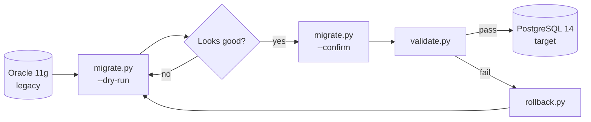

<div align="center">

# 🏦 DofBank Internal Tools

**Schema & data migration toolkit for the DofBank Core Banking System (v2 upgrade)**


[Overview](#-overview) · [Quick start](#-quick-start) · [Usage](#-usage) · [Phases](#-migration-phases) · [Structure](#-project-structure) · [Safety](#-safety-rules)

</div>

---

## 📖 Overview

Python scripts that move **account data**, **transaction history**, and **customer records**
from the legacy **Oracle 11g** database to the new **PostgreSQL 14** backend.

Scripts are organized by migration phase and **must be run in order**.



---

## ⚡ Quick start

**Requirements:** Python 3.9+, `psycopg2-binary`, `SQLAlchemy 1.4`, `python-dotenv`, `tqdm`

```bash
# 1. Install dependencies
pip install -r requirements.txt

# 2. Configure environment
cp .env.example .env     # then fill in your connection settings

# 3. Always start with a dry run
python migrate.py --phase 1 --dry-run
```

---

## 🧰 Usage

| Task | Command |
|------|---------|
| 🧪 Dry run (no writes) | `python migrate.py --phase 1 --dry-run` |
| ▶️ Run one phase | `python migrate.py --phase 2 --confirm` |
| 🚀 Run all phases in order | `python migrate.py --phase all --confirm` |
| ✅ Validate output | `python validate.py --phase 1` |
| ⏪ Roll back a phase | `python migrate.py --rollback --phase 2` |

---

## 🗺️ Migration phases

| Phase | Description | Status | Progress |
|:-----:|-------------|:------:|----------|
| 1 | User accounts table | ✅ Complete | `██████████` 100% |
| 2 | Transaction history | ✅ Complete | `██████████` 100% |
| 3 | IBAN mapping | 🔄 In progress | `█████░░░░░` active |
| 4 | Audit logs | ⏳ Pending | `░░░░░░░░░░` |
| 5 | Archival data | ⏳ Pending | `░░░░░░░░░░` |

---

## 🛡️ Safety rules

> [!CAUTION]
> **Do not run on production between 08:00 and 18:00.**

> [!WARNING]
> **Phase 3 is unstable on datasets larger than 500k rows.** Use `batch_size=100`.

> [!IMPORTANT]
> Always run `--dry-run` before any live migration.

All operations are logged to `./logs/migration.log`.

---

## 📁 Project structure

```
dofbank-tools/
├── migrate.py              # Main migration runner
├── validate.py             # Post-migration validation
├── rollback.py             # Rollback utility
├── requirements.txt        # Python dependencies
├── .env.example            # Environment variables template
├── config/
│   ├── database.py         # DB connection settings
│   └── phases.py           # Phase definitions
├── phases/
│   ├── phase1_users.py
│   ├── phase2_transactions.py
│   └── phase3_iban.py
├── utils/
│   ├── logger.py
│   ├── checksums.py
│   └── validators.py
└── logs/                   # Runtime logs (gitignored)
```

---

## 🤝 Contributing

Internal use only. Contact the **DofBank DevOps team** for access.

---

<div align="center">
  <sub>DofBank Core Banking System · Migration Project 2024<br/>
  <b>Proprietary. Do not distribute.</b></sub>
</div>
